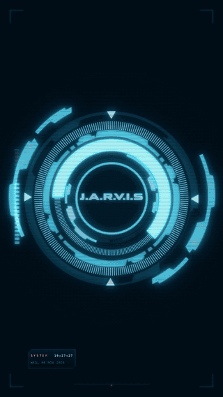

**[Download (latest release)](https://github.com/builtmyjarvis/ARC/releases/latest) · [Join the Discord](https://discord.gg/6PdHN4pz3q) · [Free AI rules file](https://builtmyjarvis.gumroad.com/l/jarvis-rules)**

# A.R.C.

**Your own voice assistant with a Stark-style HUD. Free. Windows. Talk to your PC like Tony talks to JARVIS.**

I'm Noah, 18, from Germany. I built A.R.C. because I wanted a JARVIS that actually does things on my PC, not another chat window. It runs on your own computer, uses your own free Google AI key, and keeps its memory in plain text files you can read and edit.

## What it does
- Opens and closes apps and websites ("open Spotify", "close Discord")
- Plays a specific song, artist or playlist in the Spotify app (no Premium needed)
- Looks things up live (news, sports scores, opening hours)
- Weather, timers and reminders
- Controls music and volume
- Looks at your screen ("what's this error?")
- Remembers things for good, in Markdown notes (works with Obsidian)
- Updates itself with one click

## Setup (about 10 minutes)
1. Download A.R.C. (link below) and unzip it somewhere it can stay.
2. Double-click `Setup A.R.C..bat`. It installs Python if you don't have it.
3. Paste your free Google AI key when asked (aistudio.google.com/apikey, private Google account, 18+).
4. Double-click the icon on your desktop and talk. **F8** = talk.

## Download
Join the Discord, the download and help are in **#get-started**:
**https://discord.gg/6PdHN4pz3q**

## Honest limits
- Windows only for now.
- Needs a Google AI key (free tier has daily limits).
- Headphones work best, on loud speakers it can hear itself.
- It's one person's project. Bugs get fixed in the Discord, fast.

## Roadmap (from what people ask for)
Hand tracking, controlling the browser, a night shift mode that keeps working while you sleep. Tell me what you want first in the Discord.

## License
Free to install and use on your own computers. See `LICENSE.txt`.

Built by Noah (builtmyjarvis).

## More free tools

- [clipmeter](https://github.com/builtmyjarvis/clipmeter): measure any short video with numbers (cuts, brightness, motion, speaking speed) instead of guessing, then copy the style. Works as a Claude skill.
